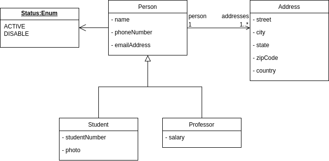

# BJ Management

API REST e interface web para gerenciamento de pessoas, estudantes, professores e endereços. O projeto utiliza Java e Spring Boot no backend, React e TypeScript no frontend, e Docker Compose para facilitar a construção e execução do sistema completo.

## Visão geral

O BJ Management permite cadastrar, consultar, editar e excluir estudantes, professores e endereços associados às pessoas cadastradas.

A aplicação é dividida em duas partes:

- **Backend:** API CRUD desenvolvida com Java 21, Spring Boot, Spring Data JPA e Hibernate.
- **Frontend:** interface administrativa desenvolvida com React, TypeScript e Vite.
- **Banco de dados:** H2 em memória.
- **Infraestrutura:** Dockerfiles e Docker Compose para orquestrar os serviços.

## Tecnologias

- Java 21
- Spring Boot 4.1.1
- Maven e Maven Wrapper
- Spring Web
- Spring Data JPA
- Hibernate
- H2 Database
- JUnit
- Mockito
- Spring Boot Test
- React
- TypeScript
- Vite
- CSS
- Docker
- Nginx 

## Modelo de domínio

O modelo representa pessoas, estudantes, professores e endereços.



- **Person:** nome, telefone, e-mail, status e relacionamento com endereços.
- **Student:** herda os atributos de `Person` e adiciona número de matrícula e foto.
- **Professor:** herda os atributos de `Person` e adiciona salário.
- **Address:** rua, cidade, estado, CEP e país; cada endereço pertence a uma pessoa.
- **Status:** `ACTIVE` ou `DISABLED`.

A herança utiliza `InheritanceType.JOINED`: os atributos comuns ficam na tabela `PERSON`, enquanto os atributos específicos ficam nas tabelas `STUDENT` e `PROFESSOR`, relacionadas pelo mesmo ID. Uma pessoa pode possuir vários endereços, mas cada endereço pertence a uma única pessoa.

**Diagrama:** o arquivo `diagrama-modelo.png` deve estar na pasta `docs`, na raiz do repositório.

## Estrutura do projeto

```text
api-bj-management/
├── src/
│   ├── main/
│   │   ├── java/br/com/bjmanagement/
│   │   │   ├── controller/
│   │   │   ├── service/
│   │   │   ├── repository/
│   │   │   ├── model/
│   │   │   └── exception/
│   │   └── resources/
│   │       ├── application.yaml
│   │       └── data.sql
│   └── test/
│       └── java/br/com/bjmanagement/
│           ├── repository/
│           └── service/
├── frontend/
│   ├── src/
│   │   ├── components/
│   │   ├── services/
│   │   ├── App.tsx
│   │   └── types.ts
│   ├── Dockerfile-app
│   ├── nginx.conf
│   ├── package.json
│   └── package-lock.json
├── docs/
│   └── diagrama-modelo.png
├── .dockerignore
├── Dockerfile-api
├── docker-compose.yaml
├── mvnw
├── mvnw.cmd
├── pom.xml
└── README.md
```
A estrutura acima apresenta os principais arquivos e diretórios do projeto.

### Organização do backend

O backend segue uma arquitetura em camadas:

- **Controller:** recebe as requisições HTTP e retorna as respostas da API.
- **Service:** concentra a lógica de negócio.
- **Repository:** utiliza Spring Data JPA para consultar, salvar e excluir registros.
- **Model:** contém as entidades `Person`, `Student`, `Professor` e `Address`, além do enum `Status`.
- **Exception:** reúne exceções personalizadas e o tratamento global de erros.
- **Resources:** contém as configurações da aplicação e o script `data.sql`.
- **Test:** contém testes unitários dos serviços e testes de integração dos repositórios.

### Organização do frontend

O frontend separa a interface, os formulários, os tipos e as chamadas HTTP.

- `App.tsx`: tela principal e coordenação dos fluxos.
- `types.ts`: tipos de domínio utilizados pela interface.
- `components/PersonForm.tsx`: formulário de estudantes e professores.
- `components/AddressForm.tsx`: formulário de endereços.
- `components/Modal.tsx`: componente de modal reutilizável.
- `services/api.ts`: fachada das operações de API.
- `services/api/client.ts`: cliente HTTP e tratamento de respostas e erros.
- `services/api/students.ts`: operações de estudantes.
- `services/api/professors.ts`: operações de professores.
- `services/api/addresses.ts`: operações de endereços.
- `services/api/people.ts`: operações de consulta de pessoas.

# Interface

A aplicação possui uma interface administrativa ,tabela de visualização de pessoas e endereços e formulários para cadastro e edição.

Funcionalidades disponíveis:

- Visualização unificada de estudantes e professores.
- Visualização de endereços.
- Busca por nome ou e-mail na listagem de pessoas.
- Cadastro, edição e exclusão de estudantes.
- Cadastro, edição e exclusão de professores.
- Cadastro, edição e exclusão de endereços.
- Confirmação antes de excluir registros.
- Mensagens de sucesso e erro nas operações.

## Endpoints da API

Todos os endpoints utilizam o prefixo `/api`.

### Pessoas

| Método | Endpoint | Descrição |
|---|---|---|
| POST | `/api/person` | Cadastrar pessoa |
| GET | `/api/person` | Listar pessoas |
| GET | `/api/person/{id}` | Buscar pessoa por ID |
| PUT | `/api/person/{id}` | Atualizar pessoa |
| PATCH | `/api/person/{id}` | Atualizar parcialmente |
| DELETE | `/api/person/{id}` | Excluir pessoa |

### Estudantes

| Método | Endpoint | Descrição |
|---|---|---|
| POST | `/api/student` | Cadastrar estudante |
| GET | `/api/student` | Listar estudantes |
| GET | `/api/student/{id}` | Buscar estudante por ID |
| PUT | `/api/student/{id}` | Atualizar estudante |
| PATCH | `/api/student/{id}` | Atualizar parcialmente |
| DELETE | `/api/student/{id}` | Excluir estudante |

### Professores

| Método | Endpoint | Descrição |
|---|---|---|
| POST | `/api/professor` | Cadastrar professor |
| GET | `/api/professor` | Listar professores |
| GET | `/api/professor/{id}` | Buscar professor por ID |
| PUT | `/api/professor/{id}` | Atualizar professor |
| PATCH | `/api/professor/{id}` | Atualizar parcialmente |
| DELETE | `/api/professor/{id}` | Excluir professor |

### Endereços

| Método | Endpoint | Descrição |
|---|---|---|
| POST | `/api/address` | Cadastrar endereço |
| GET | `/api/address` | Listar endereços |
| GET | `/api/address/{id}` | Buscar endereço por ID |
| PUT | `/api/address/{id}` | Atualizar endereço |
| PATCH | `/api/address/{id}` | Atualizar parcialmente |
| DELETE | `/api/address/{id}` | Excluir endereço |

As operações de criação retornam HTTP 201 e as exclusões bem-sucedidas retornam HTTP 204.

## Exemplos de requisições

### Cadastrar estudante

`POST /api/student`

```json
{
  "name": "João Silva",
  "phoneNumber": "41999999999",
  "emailAddress": "joao@email.com",
  "status": "ACTIVE",
  "studentNumber": "2026001",
  "photo": "joao.jpg"
}
```

### Cadastrar professor

`POST /api/professor`

```json
{
  "name": "Maria Oliveira",
  "phoneNumber": "41988887777",
  "emailAddress": "maria@universidade.com",
  "status": "ACTIVE",
  "salary": 8500.00
}
```

### Cadastrar endereço

`POST /api/address`

A pessoa referenciada precisa existir previamente.

```json
{
  "street": "Rua das Flores, 100",
  "city": "Curitiba",
  "state": "PR",
  "zipCode": "80000-000",
  "country": "Brasil",
  "person": {
    "id": 101
  }
}
```

Substitua o ID pelo identificador de uma pessoa existente.

## Executar com Docker

O projeto inclui Dockerfiles com construção em etapas. O backend é compilado com Maven Wrapper dentro de uma imagem Java, enquanto o frontend é compilado com Node.js e servido por Nginx.

Dessa forma, não é necessário instalar Java, Maven ou Node.js na máquina que executará a versão containerizada do sistema.

### Pré-requisitos

- Git.
- Docker Desktop ou Docker Engine.
- Docker Compose.

### Clonar o repositório

```bash
git clone https://github.com/eduardoconst/api-bj-management
cd api-bj-management
```

### Construir e iniciar a aplicação

Na raiz do projeto, execute:

```bash
docker compose up --build -d
```

Esse comando constrói as imagens necessárias e inicia os containers em segundo plano. No primeiro build, o Docker poderá baixar imagens-base e dependências, portanto a execução pode demorar mais.

Não é necessário executar previamente `mvnw clean package` ou `npm run build`: essas etapas são realizadas pelos respectivos Dockerfiles.

### Acessar a aplicação

| Serviço | Endereço |
|---|---|
| Frontend | http://localhost:5173 |
| API | http://localhost:8080 |
| Console H2 | http://localhost:8080/h2-console |

## Execução local

### Pré-requisitos

- JDK 21.
- Node.js 20 ou superior.
- Git.
- Maven Wrapper incluído no repositório.

### Executar o backend

Na raiz do projeto, execute:

```powershell
.\mvnw.cmd spring-boot:run
```

A API ficará disponível em `http://localhost:8080`.

### Executar o frontend

Com o backend em execução, abra outro terminal:

```powershell
cd frontend
npm install
npm run dev
```

Acesse `http://localhost:5173`.

No desenvolvimento, o frontend utiliza o proxy configurado no Vite para encaminhar as requisições à API.

### Gerar o build de produção do frontend

Dentro da pasta `frontend`:

```powershell
npm ci
npm run build
```

Os arquivos estáticos de produção serão gerados na pasta `frontend/dist`.

### Como funciona a comunicação entre os serviços

O Docker Compose gerencia os serviços `api` e `frontend` em uma rede interna.

O backend executa o Spring Boot na porta 8080. O frontend utiliza o Nginx para servir os arquivos estáticos produzidos pelo Vite e encaminhar as requisições iniciadas por `/api/` para `http://api:8080`.

Assim, o navegador acessa o frontend por `http://localhost:5173`, enquanto o Nginx realiza o encaminhamento das chamadas HTTP para o backend.

A configuração evita depender do proxy de desenvolvimento do Vite em produção.

**Observação:** a configuração atual publica a porta 8080 do backend para facilitar o acesso direto durante o desenvolvimento. O H2 Console deve permanecer restrito ao ambiente local e não deve ser exposto publicamente.

## Banco de dados H2

A aplicação utiliza H2 em memória. O banco é recriado quando a aplicação é reiniciada, e os dados iniciais definidos em `data.sql` são carregados novamente.

### Acessar o console H2

Com a aplicação em execução, acesse `http://localhost:8080/h2-console`.

| Campo | Valor |
|---|---|
| Driver Class | `org.h2.Driver` |
| JDBC URL | `jdbc:h2:mem:bjdb` |
| User Name | `BJ` |
| Password | Deixar em branco |

Clique em **Connect**.

### Consultar pessoas

No console H2, execute:

```sql
SELECT
    p.ID,
    p.NAME,
    p.PHONE_NUMBER,
    p.EMAIL_ADDRESS,
    p.STATUS,
    s.STUDENT_NUMBER,
    s.PHOTO,
    pr.SALARY,
    CASE
        WHEN s.ID IS NOT NULL THEN 'STUDENT'
        WHEN pr.ID IS NOT NULL THEN 'PROFESSOR'
        ELSE 'PERSON'
    END AS PERSON_TYPE
FROM PERSON p
LEFT JOIN STUDENT s ON s.ID = p.ID
LEFT JOIN PROFESSOR pr ON pr.ID = p.ID
ORDER BY p.ID;
```

Os `LEFT JOIN` permitem retornar todas as pessoas, inclusive aquelas que não possuem registro nas tabelas de estudantes ou professores. A coluna `PERSON_TYPE` identifica o tipo de registro.

### Consultar endereços

```sql
SELECT
    a.ID,
    a.STREET,
    a.CITY,
    a.STATE,
    a.ZIP_CODE,
    a.COUNTRY,
    a.PERSON_ID,
    p.NAME AS PERSON_NAME
FROM ADDRESS a
JOIN PERSON p ON p.ID = a.PERSON_ID
ORDER BY a.ID;
```

### Importante sobre os dados

- Os dados cadastrados pela API são mantidos enquanto a aplicação estiver em execução.
- Ao reiniciar a aplicação, o banco em memória é recriado.
- Os dados iniciais definidos em `data.sql` são carregados novamente.
- Dados inseridos manualmente pelo console não permanecem após o reinício.
- A execução com Docker Compose não torna o banco persistente: os dados continuam em memória dentro da aplicação.

## Testes Unitários

Para executar toda a suíte de testes do backend:

```powershell
.\mvnw.cmd test
```

Para executar individualmente um teste de integração:

```powershell
.\mvnw.cmd -Dtest=PersonRepositoryIntegrationTest test
```

A suíte contempla testes unitários dos serviços com JUnit e Mockito e testes de integração dos repositórios com H2.

### Cobertura dos testes

- **PersonServiceTests:** criação, listagem, busca por ID, atualização completa e parcial, exclusão e cenários com ID inexistente.
- **StudentServiceTests:** operações CRUD, atualização parcial e validação dos atributos herdados e específicos de estudante.
- **ProfessorServiceTests:** operações CRUD, atualização parcial e validação dos atributos herdados e do salário.
- **AddressServiceTests:** operações CRUD, atualização da pessoa associada, validação da referência à pessoa e cenários com endereço ou pessoa inexistente.
- **PersonRepositoryIntegrationTest:** persistência e recuperação de uma pessoa no H2.
- **StudentRepositoryIntegrationTest:** persistência dos dados herdados e dos atributos específicos de estudante.
- **ProfessorRepositoryIntegrationTest:** persistência dos dados herdados e do salário.
- **AddressRepositoryIntegrationTest:** persistência do endereço e recuperação da pessoa associada.

Os testes de serviço usam repositórios simulados para verificar a lógica da camada de negócio. Os testes de integração utilizam `@DataJpaTest` para validar a persistência via JPA e H2.

Essa suíte não representa, por si só, testes automatizados de ponta a ponta dos endpoints HTTP.

## Tratamento de erros

A API utiliza `@RestControllerAdvice` para padronizar as respostas de erro.

- **HTTP 404 — Not Found:** recurso não encontrado.
- **HTTP 400 — Bad Request:** requisição inválida, como uma referência de pessoa ausente no cadastro de endereço.

As respostas incluem data e hora, código HTTP, descrição do erro e mensagem explicativa.

O frontend apresenta mensagens de sucesso ou erro e atualiza a tabela após operações concluídas com sucesso.

## Decisões técnicas

- **Herança com `InheritanceType.JOINED`:** os atributos comuns são armazenados em `PERSON`, enquanto os campos específicos ficam nas tabelas `STUDENT` e `PROFESSOR`.
- **Relacionamento entre pessoa e endereço:** cada endereço referencia uma pessoa por meio de `person.id`.
- **Serialização JSON:** a lista de endereços de `Person` é ignorada na serialização direta para evitar recursão JSON.
- **Referência da foto:** o campo `photo` armazena uma referência textual; o upload de arquivos não está implementado.
- **Frontend separado:** React e TypeScript permitem manter a interface independente da implementação interna do backend.
- **Nginx como proxy reverso:** encaminha as requisições `/api/` ao backend e serve os arquivos estáticos do frontend.
- **Dockerfiles:** separa a compilação da execução, evitando incluir as ferramentas de build na imagem final de cada serviço.
- **Docker-Compose:** centraliza a construção e a execução do frontend e do backend.

## Possíveis melhorias futuras

- Adicionar persistência de dados com um banco externo.
- Implementar upload e armazenamento de fotos dos estudantes.
- Avaliar o uso de DTOs para controlar os dados de entrada e saída e permitir respostas agregadas com informações de pessoas e endereços.
- Ampliar a cobertura automatizada com testes dos controllers e das respostas HTTP.
- Avaliar melhorias de validação dos dados de entrada conforme os requisitos do projeto.
- Adicionar healthchecks e condições de inicialização dos serviços no Docker Compose.